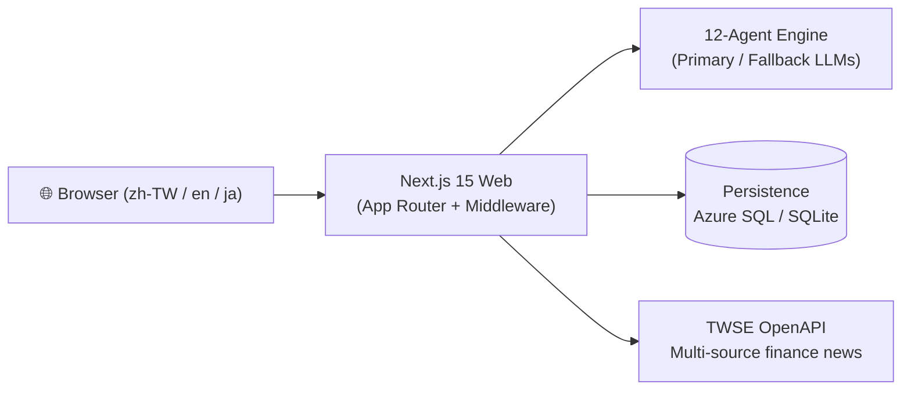

**English** ｜ [繁體中文](./README_zh.md)

# Vestential — Taiwan & US Stock AI Analysis and Odd-Lot Gift Intelligence Platform

> **About the name**: **Vestential = Vest + Essential**. *Vest* stands for "invest", *Essential* for "indispensable" — a Taiwan and US stock research platform built for value investors.

Vestential is a Taiwan and US stock investment assistant built on Next.js 15 with a multi-agent architecture. It offers in-depth AI stock analysis, post-close odd-lot quotes, integrated shareholder-meeting gift intelligence, personal holdings P&L estimation (after-tax net P&L, portfolio risk dashboard, trading journal), 60-day moving-average deviation and cycle-entry model backtesting (with AI interpretation), and a closed trading-strategy loop (ideas → backtest → plan).

* **Live site**: [https://vestential.com](https://vestential.com)
* **Support email**: `service@vestential.com`

---

## 🌟 Feature Overview

| Module | Route | Highlights | Sign-in |
| :--- | :--- | :--- | :---: |
| 🏠 **Home** | `/` | Quick tour of the core features, 6 curated multi-source AI market highlights, closing section on master investors' principles | Not required |
| 📰 **AI Market Focus** | `/market-focus` | Aggregates cnyes, Economic Daily News and Yahoo Finance into 10 balanced stories with plain-language AI summaries (including structured news-impact fields) | Not required |
| 🤖 **AI Stock Analysis** | `/analyze` | 12-agent deep dive (technical, sentiment, macro, fundamentals, bull/bear debate, research-director ruling, trader proposal, three-way risk debate, portfolio-manager decision) with a 0.3s circuit breaker for invalid symbols | Required |
| 🎁 **Odd-Lot Intelligence** | `/odd-lot` | Direct TWSE TWT53U post-close odd-lot data, 7 thematic categories, 5-year gift history cross-validated against official dates | Not required |
| 💰 **Portfolio P&L** | `/portfolio` | TW/US holdings, bulk broker-statement OCR, the five investment rules, after-tax net P&L shown side by side, total-return spread, a single yield column (trailing 12 months, TTM) with a details modal (YTD, 5-year average at today's price, per-year realized yield on the ex-date prior close), risk dashboard + stress test, card and table views, guest mode with a 120-bit claim code | Partial |
| 📒 **Trading Journal** | `/journal` (nav entry removed; direct URL still works) | Trade record CRUD + monthly stats + AI review (discipline attribution; shares the tiered quota with `analyze`: 1/day for users, 3/day for admins) | Required |
| 🌕 **Festival Banner** | Site-wide (below the header) | Automatically shows a greeting banner on the holiday and restores the next day; festival social posts are published fully automatically | Not required |
| 📉 **MA Deviation Backtest** | `/backtest` | 60-day moving-average deviation algorithm, 3 major swing-style cards, live bidirectional symbol/Chinese-name lookup, top-20 volume ranking, one-click idea backtest, AI interpretation (numbers may not be invented) | Not required |
| 🔄 **Cycle Entry** | `/cycle-entry` | Scans the whole market for symbols that have "reached a suitable entry point", with cycle timing and strength assessment, updated automatically after close | Not required |
| ⚔️ **AI Agent Arena** | `/agent-arena` | 4 fixed-persona AI agents (NT$500,000 starting capital) making five-stage decisions on Taiwan time; universe is the top 200 by market cap plus ETFs; trades include dividend credits and remaining-cash disclosure; daily leaderboard | Not required |
| 📧 **Newsletter** | `/market-focus#subscribe` | One "Market Focus Digest" email per day straight to subscribers (admins additionally receive anomaly alerts); one-click unsubscribe | Not required |
| 📈 **Symbol Page** | `/stock/[symbol]` | Deep data browsing and the analysis entry point for a single symbol | Not required |
| 🔐 **Admin Console** | `/admin` | Admin backend (social-post dry run, festival posting, first-reply Q&A toggle, arena inspection, usage, settings) | Admin |
| 🔐 **Sign In** | `/login` | Google and LINE third-party quick sign-in; manages the daily free quota securely | — |

👉 For the algorithms, formulas and workflows behind each feature, see the [Feature & Module Guide](./docs/features-guide.md).

---

## 🏗️ Architecture

The platform uses a modern monorepo layout with a high-availability design:



- **Full stack**: Next.js 15 (React 19, App Router) + Tailwind CSS.
- **AI engine**: multi-agent collaboration with a three-tier hot fallback (primary Google Gemini → fallback 1, Groq new key → fallback 2, Groq old key, separate pools) plus staggering/backoff so the service stays up (see the tech guide, §4).
- **Dual database**: SQLite for local development, Azure SQL Server in production, with incremental migrations and anti-wipe protection.
- **i18n**: built-in Traditional Chinese, English and Japanese routes with live switching.

👉 For the multi-agent architecture and fault-tolerance design, see the [Architecture & Tech Guide](./docs/architecture-and-tech.md).

---

## 🚀 Quick Start

Three steps to get the full development environment running locally.

### 1. Install dependencies and configure the environment

```bash
# install all workspace dependencies
npm ci

# create your local env file
cp .env.example .env.local
```

Put your LLM API key in `.env.local` (OpenAI-compatible, Gemini and Groq are supported):

```env
LLM_PROVIDER=openai
OPENAI_API_KEY=your_api_key_here
LLM_BACKEND_URL=https://opencode.ai/zen/v1
DEEP_THINK_MODEL=big-pickle
QUICK_THINK_MODEL=big-pickle
```

### 2. Initialize the database and scraping seeds

```bash
# fetch the initial odd-lot and shareholder-gift data
npm run seed --workspace=packages/database
```

### 3. Build and start the service

```bash
# build all internal packages
npm run local-build

# start the local dev server
npm run dev
```

Open [http://localhost:3000](http://localhost:3000) in your browser to get started.

---

## 📚 Documentation Index

To keep things maintainable, detailed specs and operating guides live in the `docs/` directory.

> **Note**: the documents under `docs/` use English as the main version, with a Traditional Chinese version alongside as `*_zh.md` (e.g. `features-guide_zh.md`).

- 📖 **[Feature & Module Guide](./docs/features-guide.md)**
  Covers portfolio P&L (after-tax net P&L, portfolio risk, trading journal, table view), screenshot OCR, the 7 odd-lot gift categories, MA-deviation backtesting (with AI interpretation and the idea flow), cycle entry, the AI Agent Arena (NT$500k start, top-200 universe), and the admin/social-editor rules (festival posting, first-reply Q&A).
- ⚙️ **[Architecture & Tech Guide](./docs/architecture-and-tech.md)**
  Monorepo layout, 12-agent collaboration logic, the 0.3s circuit breaker, primary/fallback dual-model redundancy, persistence, and the modules added in 2026-09.
- ☁️ **[Azure Deployment & Ops Guide](./docs/deployment-and-ops.md)**
  GitHub Actions CI/CD, the packaging trick that avoids the Oryx out-of-memory failure, the secrets list, the issue-driven dev loop (`/dev-loop`), 9 scheduled jobs plus auto deploy, social-credential operations and troubleshooting.
- 🔐 **[Auth & Quota Guide](./docs/auth-and-quota.md)**
  Google and LINE OAuth setup, JWT session security, the tiered AI analysis quota (1/day for users, 3/day for admins) and the 10-image recognition quota.
- ✉️ **[Custom Domain Email Setup](./docs/custom-domain-email-setup.md)**
  Building a 100% free `service@vestential.com` support inbox with Spaceship forwarding plus Gmail SMTP.
- 🎨 **[Design Assets](./docs/design/)**
  Design guideline (`design-guideline.md`) and the logo history (`docs/design/icons/`).

---

## 📄 License

This project is released under the **Sustainable Use License 1.0 (SUL)** (fair-code / source-available, the same model as n8n):

- ✅ **Personal, research and non-commercial use**: free of charge. The source is public on GitHub, open for study and personal use.
- ❌ **Commercial restriction**: deploying this project or a derivative as a paid commercial service, or reselling it to third parties, is not allowed without permission.
- 🔒 **Commercial licensing**: for commercial use, open a GitHub [Issue](https://github.com/YozoraRoy/vestential/issues) or email `service@vestential.com`.

See [`LICENSE`](./LICENSE) for the full terms.
