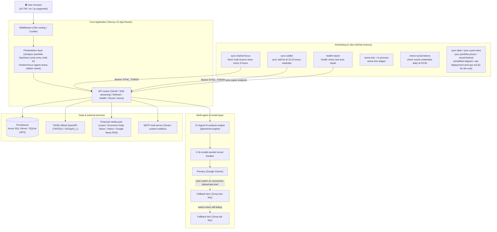

**English** ｜ [繁體中文](./architecture-and-tech_zh.md)

# Architecture & Tech Guide

This document explains Vestential's monorepo layout, the 12-Agent AI collaboration engine, the two-tier LLM fallback and the dual-database persistence mechanism.

---

## 1. Architecture Overview

---

## 2. Monorepo Workspace Layout

The project is managed with an npm workspaces architecture:

| Package / directory | Responsibility |
| :--- | :--- |
| **`apps/web`** | Next.js 15 modern web front end, using the App Router, Tailwind CSS and Server Actions. |
| **`packages/ai-engine`** | 12 specialist analysis agents, prompt templates, the 0.3s invalid-instrument gate and the investment-rules engine. |
| **`packages/backtest`** | The 60-day moving-average deviation backtest algorithm, win-rate computation and historical backtest data caching. |
| **`packages/cycle-entry`** | The cycle-entry backtest engine (`rules.ts` / `runSignalBacktest`), used by `/cycle-entry` and the admin. |
| **`packages/database`** | The dual-database abstraction layer (SQLite / Azure SQL), migration scripts and batch sync scheduling. |
| **`packages/market-data`** | Yahoo Finance statement fetching, TWSE post-close data cleaning and historical price/volume caching. |
| **`packages/core`** | Global type definitions, configuration constants and custom exception error classes. |

---

## 3. 12-Agent AI Collaboration Engine (`/analyze` supports Taiwan stocks only)

When you enter `/analyze` for a deep analysis, the system starts 12 specialist agents in sequence, each with its own role:

1. **Market Technical Analyst**: computes moving-average bullish/bearish alignment, KD/RSI momentum and key support/resistance.
2. **Sentiment Analyst**: analyses social-discussion heat and retail fear/greed indicators.
3. **News & Macro Analyst**: combs through major news headlines and central-bank monetary policy effects.
4. **Fundamentals Analyst**: reviews the three financial statements, gross margin, free cash flow and valuation level.
5. **Bull Researcher**: digs out potential bullish themes and profit breakout points.
6. **Bear Researcher**: digs out potential bearish risks and downside trigger points, and debates the bull side for one round.
7. **Research Manager**: integrates the bull and bear views and rules on the final rating (buy / hold / sell).
8. **Trader**: formulates concrete entry points, scaling-in levels and stop-loss/take-profit prices (most schema fields are optional, and a missing field does not block the main flow).
9. **Aggressive Analyst**: one of the risk trio, challenging the trade proposal from a high-risk-appetite angle.
10. **Conservative Analyst**: one of the risk trio, challenging the trade proposal from a low-risk-appetite angle.
11. **Neutral Analyst**: one of the risk trio, rebalancing offence and defence from a neutral angle.
12. **Portfolio Manager**: gives the final allocation ratio from the perspective of overall asset allocation and risk diversification.

> **Model grouping (as measured in the engine)**: Bull/Bear/Trader/the risk trio (Aggressive/Conservative/Neutral) use quickLLM; Research Manager/Portfolio Manager use deepLLM; the other analysts (Market/Sentiment/News/Fundamentals) use quickLLM.

> **0.3s invalid-symbol circuit breaker (Early-Exit Guard)**:
> Before spending LLM quota, the system first validates the stock symbol's authenticity at high speed in memory. If the entered code does not exist, it immediately returns an error within 0.3 seconds and prompts for a correction, avoiding wasted waiting time and daily quota for the user.
>
> **Taiwan-stock-only gate (`/analyze` does not support US stocks)**:
> `/analyze` accepts only Taiwan-stock symbols (plain digits, 4~6 characters, optionally with `.TW`/`.TWO`, either case).
> The front end first does real-time format validation (no API call if it does not match); the `/api/analyze` backend then validates the format again (returns 400 if it does not match, without deducting quota or creating a job);
> warrants/bull-bear certificates are judged by the backend Yahoo `quoteType` (only `EQUITY`/`ETF` pass, the rest are blocked, with the judgment made before quota deduction).
> The backend's Yahoo US reading capability in market-data/ai-engine is retained (it is a shared component, and `/portfolio` still keeps both the Taiwan and US markets).

---

## 4. Three-tier LLM Fallback (Primary / Fallback / Fallback2)

To avoid a single model provider hitting a Rate Limit (429), a timeout or quota exhaustion, the system has a built-in **three-tier hot fallback** (`FallbackClient`, with circuit-breaker cooldown: 60 seconds for ordinary cases / 10 minutes for a deterministic failure, and automatic re-probing and switching back when the cooldown ends).

### Production chain as it stands (hard-coded in deploy.yml, since 2026-09-23)
- **Primary**: `google` (`gemini-2.5-flash`, `GOOGLE_GENERATIVE_AI_API_KEY`, supports comma-separated multi-key rotation).
- **Fallback 1**: `openai`-compatible (`qwen/qwen3.8-27b` via Groq, using the new `FALLBACK_*_API_KEY`).
- **Fallback 2**: the same model via Groq, using the old `FALLBACK2_*_API_KEY`.
- When building the chain it automatically checks pool diversity (`checkFallbackPoolDiversity`, warning when the model and key are the same); the primary/fallback previously shared the same key and pool, causing a burst of OTPM errors in the 2026-09-23 morning session (see §5 Q4 of `docs/deployment-and-ops.md`), which was resolved by splitting the pool with a new key.

### Model grouping and switch marking (retained)
- **Deep group (heavy-reasoning deep decisions)**: handles Research Manager and Portfolio Manager.
- **Quick group (fast data and sentiment summaries)**: handles Technical, Sentiment, News, Fundamentals, Bull Researcher and Trader.
- After a switch, the end of the analysis report is automatically marked with `⚠️ This reply has been automatically switched to the fallback model: {model}`, and the model name and token count each Agent actually used are recorded precisely in the database (`llm_usage_logs`; the admin usage dashboard is planned as Issue-B).

### The Groq OTPM lesson and the staggering mechanism
- The hard OTPM (output tokens per minute) cap of the Groq qwen tier is **1000**, enforced as "already used + this request"; each call in the whole refresh chain is issued with max_tokens≈1000, so the further back it goes the more likely it is to blow up. `FALLBACK_SAFE_MAX_TOKENS = 1000` is the per-request cap, not a safe level.
- Countermeasures (without changing static parameters or spending money): concurrent LLM calls in the pipeline became serial + spaced (especially around the digest); 429 backoff adds jitter + retries with a smaller budget (runtime adaptive, see `llm/budget.ts`); the production value of `market_focus.summary_max_tokens` was once set to 1000 (the code default is 450), so check OTPM before changing parameters.

---

## 5. Dual-Database Compatibility and Data Persistence (Data Persistence)

This platform supports both lightweight local development and a high-availability cloud environment:

- **Local development and lightweight deployment**: uses SQLite (the database file is by default `stock.db`, or `/home/data/stock.db` in Azure persistent storage).
- **Formal cloud production environment**: setting `DATABASE_URL` automatically enables the Azure SQL Server connection pool. The production database is `stockdb` (Server `sql-stock-platform`, **Basic / 5 DTU / 2 GB**); for usage monitoring and capacity troubleshooting see §4 Q3 of `docs/deployment-and-ops.md`.
- **Anti-wipe protection (Data Loss Prevention)**: all tables are managed through SQL migration files (`packages/database/migrations`), and startup applies incremental upgrades via `IF NOT EXISTS` or `ALTER`, never resetting or emptying existing user holdings records and analysis history.

---

## 6. Internationalization and SEO

- **Next.js 15 Middleware routing**: fully supports **Traditional Chinese (`zh-TW`)**, **English (`en`)** and **Japanese (`ja`)**. It determines the preference automatically via Cookie and Accept-Language, and keeps switching free of redirects.
- **Dynamic sitemap and metadata**: dynamically generates `sitemap.xml` and `robots.txt`, publicly declaring the canonical and alternate links for all locales, meeting modern search-engine-optimization standards.

---

## 7. Modules Added in 2026-09 (Outline)

The following modules went live successively in 2026-09; for details and operating rules see §6~§8 of `docs/features-guide.md`:

### 7.1 AI Agent Arena (`/agent-arena`)
- 4 fixed-persona agents compete for votes daily across five Taiwan-time stages: premarket 09:00 (briefing) → slot 0~3 (decisions at 09:35/10:35/11:35/13:05) → 15:30 (discussion + ruling + leaderboard).
- The main clock is the **in-process** `apps/web/src/lib/arena-scheduler.ts` (`ARENA_CRON_ENABLED=true`), with GH Actions `arena-tick.yml` as fallback.
- Universe: dynamic market-cap **top 200** + ETF pool (`DEFAULT_ARENA_ETF_UNIVERSE`, replaceable via `ARENA_ETF_UNIVERSE`); on failure it falls back to `DEFAULT_ARENA_UNIVERSE`.
- New agents start with **NT$500,000** (since #27 everyone was topped up to 500k, and existing ones were back-applied); the admin can override parameters such as slippage (default `0.003`).
- Tables: `arena_agents`, `arena_rounds`, `arena_agent_actions`, `arena_round_summaries`, `arena_intraday_prices`, `arena_decision_logs`, `arena_market_briefings`, `arena_discussions`.

### 7.2 Social Editor (IG / Threads / FB)
- Every day after close it automatically generates copy + cards for the three platforms, and posts automatically after deduplication and the `hasNewEdition` threshold.
- Three card styles (`ai` / `classic` / `meme`), **default `ai` (full AI-mascot card)**; the admin can dry-run a preview.
- The publishing logic is in `apps/web/src/lib/social-trigger.ts` + `social-publish.ts`; for credential and renewal operations see §5 of `docs/deployment-and-ops.md`.
- The festival editor (separate calendar + fully automatic posting at 08:00 on the festival day + the same-day in-site banner) and the first reply asking Meta AI (self-reply + second IG comment, degraded to the default editor version because it is not open in Taiwan) are described in §8.2 of `docs/features-guide.md`.

### 7.3 Cycle Entry (`/cycle-entry`)
- A cycle-entry model scan based on the MA-deviation algorithm, updated by `sync-cycle-entry.yml` at 16:00 every trading day; the calculation engine is in `packages/cycle-entry`.

### 7.4 Admin Console (`/admin`)
- A standalone admin console (`admin/layout.tsx` guard + sidebar) with 8 sub-pages: overview, market focus, cycle entry, social editor, arena, usage, settings, subscribers.
- The guard logic is `isAdminUser` in `lib/auth.ts` (determined via `ADMIN_LINE_USER_IDS` / `ADMIN_EMAILS`).

### 7.5 Trading-Strategy Loop + Risk + Journal (late 2026-09)
- Strategy loop: one-click idea backtest, structured news impact, backtest AI interpretation (figures injected by the engine, no made-up ones), structured Trader; no additional quota.
- Portfolio risk: concentration + three scenarios + AI summary (shared quota); trading journal `/journal`: CRUD + monthly stats + AI review.
- Holdings records card | table dual view (table by default on desktop); the calculator page shows the after-tax net P&L side by side. For details see §1, §3~§4 and §9 of `docs/features-guide.md`.
