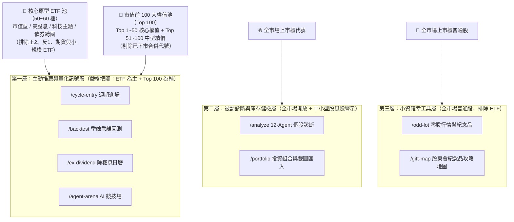

# Vestential 小資族產品定位與 Roadmap 規劃藍圖

> [!IMPORTANT]
> **核心北極星定位**
> 專為台灣小資族與上班族打造的「**ETF 智慧存股與逢低加減碼行動平台**」——以**台股原型 ETF（約 50～60 檔）為主、市值前 100 大績優權值股（台灣 50 + 中型 100 前段）為輔**，透過三層式分層架構，幫小資族避開中小型股價值陷阱，建立穩健的長期資產累積閉環。

---

## 一、全站三層式標的池架構（Tiered Universe Architecture）

### 1. 核心標的池標準（Single Source of Truth）
- **🎯 核心原型 ETF 池（預設主視角）**：
  - **收錄範圍**：台股市值型（如 `0050`、`006208`、`00922`、`00923`）、高股息型（如 `0056`、`00878`、`00919`、`00929`、`00713`、`00915`、`00918`）、科技與產業主題型（如 `00881`、`00830`、`00935`）、主動型（如 `00400A`、`00401A`）及熱門債券/跨國型（如 `00679B`、`00687B`、`00757`）。
  - **排除規則**：嚴格排除槓桿型（正 2）、反向型（反 1）、期貨型（具轉倉與波動耗損，不適用左側均值回歸）以及規模過小有清算風險之冷門 ETF。
- **🏢 市值前 100 大權值股池（輔助視角）**：
  - **分級標籤**：區分為 `Top 50 核心權值`（0050 成分股）與 `Top 51-100 中型績優`（涵蓋高股息 ETF 常用之民生、金融、高息電子成分股）。
  - **資料清理**：清理 `packages/cycle-entry/src/universe.ts` 內已合併或下市之舊代號（如 `2311` 日月光、`2823` 中壽、`2888` 新光金）與小型投機股（如 `2611` 志信、`2498` 宏達電）。

---

## 二、三階段開發路線圖（Phased Roadmap）

### 🚀 Phase 1：核心池標準化與既有模組對齊（近期優先）

- **對應 GitHub Issues**：`#128`（Phase 1-1）、`#129`（Phase 1-2，Blocked by `#128`）、`#130`（Phase 1-3，Blocked by `#128`）

| Issue | 模組 | 改造重點 | 涉及檔案 / 模組 |
| :--- | :--- | :--- | :--- |
| **#128** | **共用核心標的池 & `/cycle-entry` 週期進場** | 1. 建立全站共用的「核心原型 ETF + Top 100 權值股」標準清單與分類標籤（`ETF` / `TOP_50` / `TOP_100`），清理下市舊代號。 2. 將核心原型 ETF 納入每日掃描管線，新增 **「🎯 核心存股 ETF（預設）」** 與 **「🏢 Top 100 權值股」** 分頁切換。 | `packages/cycle-entry/src/universe.ts`、`apps/web/src/app/cycle-entry/page.tsx`、`cycle-entry-view.tsx` |
| **#129** | **`/backtest` 季線乖離回測** | 1. 將預設排行榜由「全市場成交量 Top 20（含反1/當沖股）」改為 **「🎯 熱門存股 ETF」** 與 **「🏢 Top 100 權值股」** 雙分頁。 2. **ETF 專屬回測參數**：識別標的為 ETF 時，預設停利目標由 `+25%` 調整為符合 ETF 波動的 **`+10%`**。 3. **🌱 新掛牌 ETF 觀察卡**：上市未滿 1 年（如 `00939`、`00946`、`00400A`）樣本不足時，自動顯示「上市天數、發行價距離、目前季線乖離率與近期配息」，取代空白 `0 次` 畫面。 | `apps/web/src/app/backtest/page.tsx`、`/api/backtest` |
| **#130** | **`/analyze` & `/portfolio` 風險防護** | 維持全市場代號可查詢；但當使用者查詢非核心池（市值 100 名外的中小型股）時，自動顯示 **「⚠️ 中小型股風險提示：波動較大且具個別基本面衰退風險，不適用權值股/ETF 的左側無腦攤平策略」**，並於 `/portfolio` 統計核心資產佔比。 | `apps/web/src/app/analyze/`、`apps/web/src/app/portfolio/` |

---

### 📈 Phase 2：小資族「定期定額 + 逢低加碼行動指南」（中期核心亮點 — Issue `#131`）

> [!TIP]
> **解決小資族最大痛點**：「我知道要定期定額買 ETF，但手頭有一筆年終或閒錢時，現在到底該不該加碼？加碼多少？」

1. **大盤水位 × ETF 季線乖離連動訊號**：
   - 將 `apps/web/src/app/market-level/page.tsx`（大盤巴菲特指標、融資維持率、落底雷達）與 `/backtest` 的 ETF 季線乖離率打通。
   - 在首頁與 ETF 頁面提供清晰的 **「今日定期定額加碼倍率建議」**（例如：平時定期定額 `1x` 扣款；當 ETF 觸及歷史高勝率負乖離或大盤亮綠燈時，提示 `1.5x ~ 2x` 逢低加碼）。
2. **「純定期定額 vs 逢低智慧加碼」雙軌歷史試算器**：
   - 讓小資族輸入每月預算（例如每月 NT$ 10,000），一鍵比較過去 5 年「傻傻每月固定買」與「搭配季線負乖離訊號逢低加碼」的累積總市值、平均持有成本與最大回撤差異。

---

### 🛡️ Phase 3：存股族痛點深化（中長期護城河 — Issue `#132`）

1. **ETF 配息組成拆解與二代健保補充保費試算（`/ex-dividend` & `/portfolio`）**：
   - 拆解 ETF 配息來源：**「54C 境內股利所得」vs「收益平準金」vs「資本利得（76W）」** 佔比。
   - 結合 `/portfolio` 持股張數，自動幫小資族算出**單次領息中屬於「54C 股利所得」的金額是否超過 NT$ 20,000**，提前預警 2.11% 二代健保補充保費並提供分散配置建議。
2. **ETF 與個股「穿透式成分股重疊度雷達」（`/portfolio`）**：
   - 許多小資族同時買了 `0050` + `00878` + `00919` 又單買 `2330 台積電` 或 `2454 聯發科`，卻不知道真實產業與個股集中度。
   - 透過 ETF 成分股權重穿透計算，在 `/portfolio` 視覺化呈現「真實前十大曝險個股」與「高股息 ETF 重疊度」，協助小資族真正做到分散風險。
